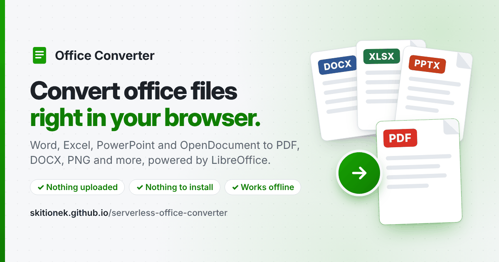

# Serverless Office Converter

[](https://skitionek.github.io/serverless-office-converter/)

Convert office documents **entirely in the browser** with **LibreOffice core compiled to
WebAssembly**, hosted as a static site on GitHub Pages. There is no server-side
component: files are converted inside the visitor's browser tab and are never uploaded.

**Live:** https://skitionek.github.io/serverless-office-converter/

## Why it's nice

* **Nothing to install.** Open the page and convert: no Word, no LibreOffice, no admin
  rights, no account. It works the same on Windows, macOS, Linux and Chromebooks.
* **Opens the old Office files that Office itself no longer will.** Current Microsoft Office
  opens Word 6.0 and Word 95 documents only read-only, in Protected View, and its *File Block*
  settings can refuse them outright, along with Excel 4.0 and Excel 95 workbooks
  ([XDA: *LibreOffice opens files from the '90s that Microsoft Office now refuses to touch*](https://www.xda-developers.com/libreoffice-opens-files-from-the-90s-that-microsoft-office-now-refuses-to-touch/)).
  This converter is LibreOffice, so it still reads them: turn **Word 6.0/95** and
  **Excel 4.0/5.0/95** files into DOCX, XLSX, PDF or OpenDocument, and they open anywhere again
  (tested with the samples in [`test/fixtures/legacy/`](test/fixtures/legacy/)). PowerPoint 95
  decks are the exception: their importer is one of the [formats left out](#size-reductions) of
  the build.
* **Built to contain malicious files.** Old file formats are a favourite way to attack office
  software: its parsers are large and old, and a crafted file can take over the program. Here
  LibreOffice runs as WebAssembly inside the browser's sandbox, not as a program on your
  computer, so a malicious document can't take over your system, and macros never run. And
  should one take over the converter itself, it still can't send your documents anywhere (a
  setting, on by default), reach the browser's storage or the folders you let the page use, or
  leave anything behind for your next visit; an optional setting also keeps it away from the
  other files you convert. See [Security](#security).
* **Your files never leave your computer.** There is no server to send them to, and you
  don't have to take our word for it, you can check it yourself:
  1. Open the page, then open DevTools (F12 or Ctrl/Cmd+Shift+I) → **Network** tab.
  2. Tick *Preserve log* and click the clear button (🚫) once the engine has loaded.
  3. Convert a file. The only things that appear are local ones (the page's own scripts and
     the engine files, served from the cache). No request carries your document anywhere,
     and no request goes to any other domain.
  4. For the ultimate proof, load the page once and then switch the Network tab's throttling
     to **Offline** (or just turn off your Wi-Fi). Conversions keep working.
* **Open and auditable.** The page is plain static files from this repository, and the
  converter is unmodified LibreOffice, not a black-box web service.
* **Fast and private for batches.** Drop many files and convert them one after another
  without any upload time, size limit or queue at someone else's server.
* **Whole folders, originals untouched.** Choose files or drop them (folders too) and download
  the results: no permission is asked. Optionally, in Chrome and Edge, results can be saved
  straight into a folder (next to the originals, if you pick their folder), and a folder can be
  watched so that documents added to it or changed are converted automatically. These use the
  File System Access API only when you ask for them: the page first explains what will happen
  and what the browser will ask, then the browser asks for permission. Inputs are only ever
  read; results are always **new files**, and a name that is taken gets ` (1)`, ` (2)`, ...
  (DOCX to DOCX gives `report (converted).docx`). Installed as an app, the converter also
  appears in the operating system's *Open with* menu.
* **Migrate old files in one go.** Choose **Newest Office format** as the default output
  format, and each file becomes the current Office format of its kind (see
  [Migrating to the newest Office formats](#migrating-to-the-newest-office-formats)). With a
  watched folder that is also the output folder, old documents dropped into it get a DOCX,
  XLSX or PPTX next to them.

| From | To |
| --- | --- |
| DOCX, DOC (Word 6.0 to 2003), ODT, RTF, TXT, Markdown, HTML, … | PDF, PDF/A, DOCX, DOC, ODT, RTF, TXT, Markdown, PNG/JPEG (first page), FODT |
| XLSX, XLS (Excel 4.0 to 2003), XLSB, ODS, CSV/TSV, Lotus, … | PDF, PDF/A, XLSX, XLS, ODS, CSV, HTML, PNG/JPEG, FODS |
| PPTX, PPT (PowerPoint 97 to 2003), ODP | PDF, PDF/A, PPTX, PPT, ODP, PNG/JPEG/SVG (first slide), FODP |
| ODG, SVG, WMF/EMF, PNG/JPEG/… | PDF, PDF/A, ODG, PNG/JPEG/SVG |

## Compatibility

Every input format against every output format the converter offers for it. Each cell was
**actually converted** in headless Chromium with the shipped engine, and the output was
validated: it must be a real file of the target type (PDF, a DOCX/XLSX/PPTX package, an ODF
package of the right type, an OLE file for DOC/XLS/PPT, a decodable PNG/JPEG, ...) **and still
have its content**: the text of the input, or for images and drawings a PDF page with content, a
slide, drawing shapes, a non-blank picture.

✅ works · ❌ fails. Every input can be turned into the **common outputs** (PDF, PDF/A, PNG,
JPG); the other tables show the outputs that depend on the kind of document.

<!-- compat:start -->
460 of 460 offered conversions produce a valid file with the content intact (690 combinations are not offered).

#### Common outputs (every input)

| From \ To | PDF | PDF/A | PNG | JPG |
| --- | :---: | :---: | :---: | :---: |
| **Text documents** | | | | |
| DOCX | ✅ | ✅ | ✅ | ✅ |
| DOC | ✅ | ✅ | ✅ | ✅ |
| ODT | ✅ | ✅ | ✅ | ✅ |
| FODT | ✅ | ✅ | ✅ | ✅ |
| RTF | ✅ | ✅ | ✅ | ✅ |
| TXT | ✅ | ✅ | ✅ | ✅ |
| MD | ✅ | ✅ | ✅ | ✅ |
| HTML | ✅ | ✅ | ✅ | ✅ |
| DOTX | ✅ | ✅ | ✅ | ✅ |
| DOCM | ✅ | ✅ | ✅ | ✅ |
| DOTM | ✅ | ✅ | ✅ | ✅ |
| OTT | ✅ | ✅ | ✅ | ✅ |
| HTM | ✅ | ✅ | ✅ | ✅ |
| XHTML | ✅ | ✅ | ✅ | ✅ |
| MARKDOWN | ✅ | ✅ | ✅ | ✅ |
| **Spreadsheets** | | | | |
| XLSX | ✅ | ✅ | ✅ | ✅ |
| XLS | ✅ | ✅ | ✅ | ✅ |
| ODS | ✅ | ✅ | ✅ | ✅ |
| FODS | ✅ | ✅ | ✅ | ✅ |
| CSV | ✅ | ✅ | ✅ | ✅ |
| TSV | ✅ | ✅ | ✅ | ✅ |
| XLTX | ✅ | ✅ | ✅ | ✅ |
| XLSM | ✅ | ✅ | ✅ | ✅ |
| XLTM | ✅ | ✅ | ✅ | ✅ |
| OTS | ✅ | ✅ | ✅ | ✅ |
| TAB | ✅ | ✅ | ✅ | ✅ |
| DIF | ✅ | ✅ | ✅ | ✅ |
| SLK | ✅ | ✅ | ✅ | ✅ |
| **Presentations** | | | | |
| PPTX | ✅ | ✅ | ✅ | ✅ |
| PPT | ✅ | ✅ | ✅ | ✅ |
| ODP | ✅ | ✅ | ✅ | ✅ |
| FODP | ✅ | ✅ | ✅ | ✅ |
| POTX | ✅ | ✅ | ✅ | ✅ |
| PPTM | ✅ | ✅ | ✅ | ✅ |
| PPSX | ✅ | ✅ | ✅ | ✅ |
| PPSM | ✅ | ✅ | ✅ | ✅ |
| OTP | ✅ | ✅ | ✅ | ✅ |
| PPS | ✅ | ✅ | ✅ | ✅ |
| POT | ✅ | ✅ | ✅ | ✅ |
| **Drawings and images** | | | | |
| SVG | ✅ | ✅ | ✅ | ✅ |
| ODG | ✅ | ✅ | ✅ | ✅ |
| PNG | ✅ | ✅ | ✅ | ✅ |
| JPG | ✅ | ✅ | ✅ | ✅ |
| OTG | ✅ | ✅ | ✅ | ✅ |
| JPEG | ✅ | ✅ | ✅ | ✅ |
| SVGZ | ✅ | ✅ | ✅ | ✅ |
| GIF | ✅ | ✅ | ✅ | ✅ |
| BMP | ✅ | ✅ | ✅ | ✅ |
| WEBP | ✅ | ✅ | ✅ | ✅ |
| TIFF | ✅ | ✅ | ✅ | ✅ |

#### Text documents: format-specific outputs

| From \ To | DOCX | DOC | ODT | RTF | TXT | MD | FODT |
| --- | :---: | :---: | :---: | :---: | :---: | :---: | :---: |
| DOCX | ✅ | ✅ | ✅ | ✅ | ✅ | ✅ | ✅ |
| DOC | ✅ | ✅ | ✅ | ✅ | ✅ | ✅ | ✅ |
| ODT | ✅ | ✅ | ✅ | ✅ | ✅ | ✅ | ✅ |
| FODT | ✅ | ✅ | ✅ | ✅ | ✅ | ✅ | ✅ |
| RTF | ✅ | ✅ | ✅ | ✅ | ✅ | ✅ | ✅ |
| TXT | ✅ | ✅ | ✅ | ✅ | ✅ | ✅ | ✅ |
| MD | ✅ | ✅ | ✅ | ✅ | ✅ | ✅ | ✅ |
| HTML | ✅ | ✅ | ✅ | ✅ | ✅ | ✅ | ✅ |
| DOTX | ✅ | ✅ | ✅ | ✅ | ✅ | ✅ | ✅ |
| DOCM | ✅ | ✅ | ✅ | ✅ | ✅ | ✅ | ✅ |
| DOTM | ✅ | ✅ | ✅ | ✅ | ✅ | ✅ | ✅ |
| OTT | ✅ | ✅ | ✅ | ✅ | ✅ | ✅ | ✅ |
| HTM | ✅ | ✅ | ✅ | ✅ | ✅ | ✅ | ✅ |
| XHTML | ✅ | ✅ | ✅ | ✅ | ✅ | ✅ | ✅ |
| MARKDOWN | ✅ | ✅ | ✅ | ✅ | ✅ | ✅ | ✅ |

#### Spreadsheets: format-specific outputs

| From \ To | XLSX | XLS | ODS | CSV | HTML | FODS |
| --- | :---: | :---: | :---: | :---: | :---: | :---: |
| XLSX | ✅ | ✅ | ✅ | ✅ | ✅ | ✅ |
| XLS | ✅ | ✅ | ✅ | ✅ | ✅ | ✅ |
| ODS | ✅ | ✅ | ✅ | ✅ | ✅ | ✅ |
| FODS | ✅ | ✅ | ✅ | ✅ | ✅ | ✅ |
| CSV | ✅ | ✅ | ✅ | ✅ | ✅ | ✅ |
| TSV | ✅ | ✅ | ✅ | ✅ | ✅ | ✅ |
| XLTX | ✅ | ✅ | ✅ | ✅ | ✅ | ✅ |
| XLSM | ✅ | ✅ | ✅ | ✅ | ✅ | ✅ |
| XLTM | ✅ | ✅ | ✅ | ✅ | ✅ | ✅ |
| OTS | ✅ | ✅ | ✅ | ✅ | ✅ | ✅ |
| TAB | ✅ | ✅ | ✅ | ✅ | ✅ | ✅ |
| DIF | ✅ | ✅ | ✅ | ✅ | ✅ | ✅ |
| SLK | ✅ | ✅ | ✅ | ✅ | ✅ | ✅ |

#### Presentations: format-specific outputs

| From \ To | PPTX | PPT | ODP | FODP | SVG |
| --- | :---: | :---: | :---: | :---: | :---: |
| PPTX | ✅ | ✅ | ✅ | ✅ | ✅ |
| PPT | ✅ | ✅ | ✅ | ✅ | ✅ |
| ODP | ✅ | ✅ | ✅ | ✅ | ✅ |
| FODP | ✅ | ✅ | ✅ | ✅ | ✅ |
| POTX | ✅ | ✅ | ✅ | ✅ | ✅ |
| PPTM | ✅ | ✅ | ✅ | ✅ | ✅ |
| PPSX | ✅ | ✅ | ✅ | ✅ | ✅ |
| PPSM | ✅ | ✅ | ✅ | ✅ | ✅ |
| OTP | ✅ | ✅ | ✅ | ✅ | ✅ |
| PPS | ✅ | ✅ | ✅ | ✅ | ✅ |
| POT | ✅ | ✅ | ✅ | ✅ | ✅ |

#### Drawings and images: format-specific outputs

| From \ To | ODG | SVG |
| --- | :---: | :---: |
| SVG | ✅ | ✅ |
| ODG | ✅ | ✅ |
| PNG | ✅ | ✅ |
| JPG | ✅ | ✅ |
| OTG | ✅ | ✅ |
| JPEG | ✅ | ✅ |
| SVGZ | ✅ | ✅ |
| GIF | ✅ | ✅ |
| BMP | ✅ | ✅ |
| WEBP | ✅ | ✅ |
| TIFF | ✅ | ✅ |
<!-- compat:end -->

Notes:

* **Not offered means tested and not working.** `node test/matrix.cjs --cross` forces each
  output's own export filter onto every kind of document it is not offered for (298
  combinations of the first 22 inputs): none works. The outcome was the same for every input of a
  kind, so it is recorded per kind in `test/forced-results.json`. In particular, Markdown is
  only available from text documents, and HTML only from spreadsheets (Writer's HTML export
  needs a component left out of the build).
* **Inputs.** 50 formats: hand-written ones (TXT, MD, HTML, CSV, TSV, DIF, SYLK, SVG), samples
  made with python-docx/openpyxl/python-pptx (DOCX, XLSX, PPTX), Pillow (GIF, BMP, WebP, TIFF), and the
  rest converted from those by this converter itself, or derived by changing the package type
  (templates, macro-enabled files) or the file extension (HTM, MARKDOWN, TAB, PPS, ...). All
  fixtures are in `test/fixtures/matrix/`. Old binary formats such as DOC, XLS and PPT are
  written by LibreOffice, not by Microsoft Office, and real-world files will vary.
* "Works" means the content survives, not pixel-perfect layout. Tables, formulas (recalculated),
  Unicode text and bullets are in the samples; complex documents will expose differences like any
  other LibreOffice conversion.
* CSV and TSV open with UTF-8 and `,` / tab separators; CSV export writes the first sheet.
* SVG export exists for slides and drawings only: LibreOffice's Writer and Calc SVG filters are
  internal and fail to export, so they're not offered.
* PNG/JPEG/SVG exports contain the first page or slide.
* Regenerate: `node test/matrix.cjs --make-fixtures && python3 test/make-extra-fixtures.py`
  (fixtures), `node test/matrix.cjs && python3 test/matrix-report.py` (tables; needs Playwright,
  poppler's `pdftotext`, Pillow and pypdf), and `node test/matrix.cjs --cross --out test/out/cross`
  then `python3 test/matrix-report.py --out test/out/cross --forced-from test/out/cross/validated.json`
  (forced combinations; over an hour, because every crash restarts the tab).

The engine is a **29.7 MB** download (xz-compressed; 94.5 MB `soffice.wasm` + 51 MB file
system image uncompressed), fetched once and then served from the browser cache. It starts in
about 10 seconds; typical conversions take 0.1–2 s.

To keep it small, the build leaves out what file conversion does not need, and some rarely
used formats (see [Size reductions](#size-reductions)): no PDF import, no Visio/Publisher/
Keynote/WordPerfect/CorelDRAW/… import, no HTML export of text documents.

## Migrating to the newest Office formats

The **Newest Office format** choice of *Default output format* picks a format per file, by its
extension:

| Files | Become |
| --- | --- |
| DOC, DOT, RTF, ODT, OTT, FODT, SXW, STW, HWP | DOCX |
| XLS, XLT, ODS, OTS, FODS, SXC, STC, Lotus (WK1, WKS, 123), Quattro Pro (WB2), SYLK, DIF, UOS | XLSX |
| PPT, PPS, POT, ODP, OTP, FODP, SXI, STI | PPTX |
| Already current: DOCX, DOCM, DOTX, DOTM, XLSX, XLSM, XLTX, XLTM, XLSB, PPTX, PPTM, PPSX, PPSM, POTX, POTM | left as they are |
| Plain text and data: TXT, Markdown, HTML, XML, CSV, TSV | left as they are |
| Drawings and images: ODG, SVG, PNG, JPEG, ... (Office has no format for them) | left as they are |

Files left as they are say why in their row and are not converted, unless a format is picked
for them there; macro-enabled files stay as they are, since converting them would drop the
macros. It applies to added files, whole folders and watched folders alike. What is read and
written is the same as for any other conversion, so the
[compatibility tables](#compatibility) and [limits](#limits) apply (for example, PowerPoint 95
files can't be opened).

## Use it in your own site (npm)

Two packages live in this repository:

* [`serverless-office-converter`](web/office-converter/README.md): the converter itself, with the
  engine included: `engine.convertFile(file, 'pdf')`.
* [`serverless-office-thumbnail`](web/office-thumbnail/README.md): the `<office-thumbnail>` web
  component used for the previews in the file list, rendered by the converter in the background.

## How it works

```
page (index.html / app.js, UI)
  └─ OfficeEngine ──postMessage──▶ engine-worker.js   (dedicated Web Worker)
       one job at a time,                Emscripten runtime + in-memory file system
       most important first                  │  MessagePort
                                             ▼
                                        LibreOffice main thread (nested worker / pthread)
                                        lo-thread.js: UNO API
                                          loadComponentFromURL(file:///tmp/…)
                                          storeToURL(…, FilterName)
       optional: a fresh                lockdown.js: no network, storage or messaging APIs
       engine per document
service-worker.js (service worker)
  • adds COOP/COEP headers → cross-origin isolation → SharedArrayBuffer (pthreads)
  • gives the engine's workers a Content Security Policy (no network but lo/)
  • serves lo/soffice.{js,wasm,data} by streaming xz parts through a small wasm xz decoder
  • keeps the decompressed files in Cache Storage (one download per release), checked
    against the SHA-256 in lo/manifest.json before each use
```

* **LibreOffice build** – `build/build-libreoffice-wasm.sh` checks out LibreOffice core from
  `git.libreoffice.org`, configures it for `--host=wasm32-local-emscripten` with
  `--disable-gui` (the headless configuration from LibreOffice's
  [`static/README.wasm.md`](https://git.libreoffice.org/core/+/refs/heads/master/static/README.wasm.md)),
  `--with-wasm-module="writer calc impress"`, and builds it with Emscripten 4.0.10. The
  result is one statically linked `soffice.wasm`, its JS glue `soffice.js` (including
  LibreOffice's Embind UNO bindings) and `soffice.data`, the in-memory file system image with
  configuration, filters' resources and fonts.
* **Conversion** – `soffice` is started with `--headless --nodefault`. LibreOffice's
  `Module.uno_scripts` hook loads `web/office-converter/lo-thread.js` into the LibreOffice main thread, which
  opens the input with `XComponentLoader.loadComponentFromURL` (hidden, macros disabled),
  detects whether it became a text document, spreadsheet, presentation or drawing, and
  saves it with `XStorable.storeToURL` using the matching export filter (see `web/office-converter/formats.js`).
* **Hosting on GitHub Pages** – Pages cannot send the `Cross-Origin-Opener-Policy` /
  `Cross-Origin-Embedder-Policy` headers that `SharedArrayBuffer` requires, so `web/office-converter/service-worker.js`
  (registered through `web/sw.js`) adds them (the page reloads itself once on the first visit). GitHub also limits file sizes,
  so `build/package-wasm.py` compresses the runtime with xz (35–40% smaller than gzip) and
  splits it into 40 MB parts listed in `web/office-converter/lo/manifest.json`; the service worker reassembles
  and decompresses them on the fly with the vendored 20 KB `web/office-converter/vendor/xz-decompress.min.js`.
* **Robustness** – the engine runs in a dedicated Web Worker, off the page's main thread; if
  LibreOffice crashes or a conversion times out, the worker is discarded and a fresh one is
  started for the next file. An engine that stops making progress while starting is given up
  on after two minutes and the job retried once, instead of every conversion waiting forever.

## Security

Every document is untrusted input to LibreOffice's C++ parsers, and old formats are where
their bugs tend to be: in 2026, for example, a crafted PowerPoint 97–2003 file could overflow
a buffer on the stack (CVE-2026-8356, fixed in the 26.2.4 releases; the shipped engine is
LibreOffice 26.8.3). The converter is set up so that such a bug gets an attacker as little as
possible:

1. **The browser's sandbox.** LibreOffice is WebAssembly in a Web Worker, not a program on the
   computer: it can't reach the operating system, other programs or any file it isn't given.
   WebAssembly also keeps return addresses out of reach of memory corruption, which rules out
   the classic stack-smashing exploit. Documents are opened hidden, without updating linked
   content, and with macros never executed.
2. **No network.** Corrupted memory can still change what the engine does, and through Embind
   it can call JavaScript, with the page's origin. So the engine's workers (the engine worker
   and LibreOffice's threads) get a Content Security Policy from the service worker: requests
   only to `lo/`, scripts only from the engine directory, no workers but LibreOffice's own
   threads. On top of that, once the engine is loaded and before any document is opened,
   `web/office-converter/lockdown.js` deletes `fetch`, `XMLHttpRequest`, `WebSocket`,
   `EventSource`, `importScripts`, ... from those workers. This is the **Block the converter's
   network access** setting in the page's **Settings** (`OfficeEngine`'s `isolateNetwork`
   option), **on by default** and free: converting never needs the network. Unticked, the
   engine worker is loaded as `engine-worker.js?network`, without the policy and network
   lockdown; a locked-down engine can't start that worker itself (its policy allows no worker
   but LibreOffice's threads, and those always get the policy).
3. **No storage, no other pages.** A policy can't restrict storage, so `lockdown.js` also
   deletes IndexedDB (where the folders for "save into a folder" and "watch a folder" are
   remembered), Cache Storage (where the engine is kept), `navigator.storage`,
   `BroadcastChannel` and the service worker API from them.
4. **Optional: a fresh engine per document.** By default one engine converts every document of
   a visit, so a document that took over the engine could read the documents converted after
   it and change their results (with point 2 it still can't send anything anywhere; it matters
   if you share those results). The **A fresh converter for each file** setting in the page's
   **Settings** (`OfficeEngine`'s `isolateDocuments` option) rules that out: each document
   gets a new engine, shared only by its own jobs, its thumbnail and its conversion. This is a
   performance fee of about **1.5 s per document** (a restart of the cached engine), so it is
   off by default.
5. **Nothing left behind.** With no storage APIs (point 3) the engine can't plant anything for
   later, and the engine files kept in Cache Storage are also checked against the SHA-256
   hashes in `lo/manifest.json` the first time the service worker uses them on a visit, and
   downloaded again if they don't match.

What a document that took over the engine can still do: produce whatever result *for itself*
(and, without point 4, for the documents after it in the same visit), fail, or hang until the
timeout. Out of reach of all this: a bug in the browser itself (keep it up to date), and other
pages on the same origin. `skitionek.github.io` is shared by every GitHub Pages site of the
account, and each of them has the same access to this origin's storage as the converter; a
custom domain would give the converter an origin of its own.

`test/security.cjs` checks points 2–5 in Chromium against the real engine: it inspects the
engine's workers, tries the usual ways out (fetch, XHR, WebSocket, scripts, workers, storage)
from a worker in the engine directory while a server on another origin counts the requests it
gets, poisons the cache, checks which engine each document gets, and that both settings do
what they say (with the network setting off, the engine does reach the other origin). Firefox and Safari get
the same policy and lockdown, but aren't tested here.

## Repository layout

| Path | Purpose |
| --- | --- |
| `web/` | The static site (deployed as-is to GitHub Pages) |
| `web/office-converter/` | npm package `serverless-office-converter`: engine client, worker, service worker, format tables and the packaged LibreOffice runtime (`lo/`, generated by the build) |
| `web/office-thumbnail/` | npm package `serverless-office-thumbnail`: the `<office-thumbnail>` web component |
| `build/build-libreoffice-wasm.sh` | Fetch, configure, build and package LibreOffice for WebAssembly |
| `build/soffice-pre.js` | Extra `--pre-js` that exposes the Emscripten `FS` to the page |
| `build/package-wasm.py` | xz + split the runtime into `web/office-converter/lo/`, drop the files in `data-exclude.txt` from `soffice.data`, write `manifest.json` |
| `build/patches/` | Size reductions applied to LibreOffice before building |
| `build/embind-allowlist.txt` | The only UNO types exposed to JavaScript |
| `build/Dockerfile` | Build environment (`emscripten/emsdk:4.0.10` + LibreOffice build deps) |
| `build/social-preview.{html,cjs}` | The link-preview image (`web/social-preview.png`), the PNG icons and the app screenshot shown in the browser's install dialog (`web/screenshot-wide.png`); `node build/social-preview.cjs` re-renders them |
| `test/e2e.cjs` | End-to-end test: serves `web/` like Pages does and converts fixtures in Chromium |
| `test/security.cjs` | Security test: what a document that took over the engine could still reach (see [Security](#security)) |
| `.github/workflows/pages.yml` | Deploys `web/` to GitHub Pages |

## Building LibreOffice for WebAssembly

```sh
# with Docker
docker build -t lo-wasm-builder build/
docker run --rm -v "$PWD:/src" -w /src lo-wasm-builder build/build-libreoffice-wasm.sh

# or natively (Linux) with an activated emsdk 4.0.10 and the packages from build/Dockerfile
source /path/to/emsdk/emsdk_env.sh
build/build-libreoffice-wasm.sh
```

Sources and the build tree go to `work/` (ignored by git); the packaged runtime is written to
`web/office-converter/lo/`. A cold build takes roughly 4 hours on 4 cores (about 2.5 h of it compiling
LibreOffice itself, the final link + Binaryen pass about 10 minutes and ~4 GB of RAM) and
needs ~25 GB of disk. Set `LO_BRANCH` to build another LibreOffice branch (the patches are
made against `libreoffice-26-8`), and `WASM_MODULES` (e.g. `"writer"`) for a smaller engine.

## Size reductions

On top of LibreOffice's own `--enable-wasm-strip` (on by default for Emscripten):

| Change | Where |
| --- | --- |
| No curl/WebDAV, no Cairo canvas | `--disable-curl --without-webdav --disable-cairo-canvas` |
| No librevenge-based import filters (Visio, Publisher, iWork, CorelDRAW, WordPerfect, Works, old Mac formats, StarOffice 5, QuarkXPress, FreeHand, PageMaker, AbiWord, e-books) | new `--disable-writerperfect` switch, `patches/0006` |
| Compile with `-Oz` instead of `-O3` | `patches/0003` |
| Embind UNO bindings only for the types in `embind-allowlist.txt` and their dependencies (48 instead of 1728 types) | `patches/0004`, with `patches/0007` keeping the exception RTTI the bridge exports |
| ICU data without per-locale display names of languages, regions, currencies, units and time zones (33 → 20 MB) | `patches/0005` |
| No spell checking, hyphenation or thesaurus code (no dictionaries ship anyway) | `patches/0002` |
| Fonts: only Liberation Sans/Serif/Mono/Sans Narrow and DejaVu Sans (regular + bold; italics are synthesized), Carlito and Caladea (all four styles), OpenSymbol | `data-exclude.txt`, applied by `package-wasm.py` |
| xz instead of gzip for the download (35–40% smaller) | `package-wasm.py`, `office-converter/service-worker.js` |

`patches/0001` fixes `--disable-curl` (uui linked curl unconditionally).

The built runtime is committed in `web/office-converter/lo/`; GitHub only deploys it and never rebuilds LibreOffice.

## Running locally

Any static file server works, because the service worker provides cross-origin isolation:

```sh
cd web && python3 -m http.server 8000
# open http://localhost:8000/
```

End-to-end and security tests (headless Chromium via Playwright):

```sh
cd test && npm install && npm test
```

## Deployment

The site is deployed to GitHub Pages at https://skitionek.github.io/serverless-office-converter/.
The **Deploy to GitHub Pages** workflow publishes `web/` as-is on every push to `main` that
touches it (it can also be run manually from the Actions tab). A fork deploys the same way once
*Settings → Pages → Build and deployment → Source* is set to *GitHub Actions*.

## Limits

* Desktop-class browsers: current Chrome, Edge, Firefox and Safari. The engine reserves 1 GB
  of WebAssembly memory, which some phones refuse.
* The first visit downloads the engine (see the size shown on the page); later visits use the
  cached copy until a new build is deployed.
* No PDF import, no password-protected documents, no macros (they are never executed).
* No PowerPoint 95 (or 1–4) import, and none of the other formats LibreOffice reads through
  libmwaw and librevenge (Works, Write, WordPerfect, ClarisWorks, …): those filters are left out
  to keep the download small (`build/patches/0006`).
* The optional fresh converter for each file (see [Security](#security)) adds about 1.5 s per
  file to a batch.
* Text documents cannot be exported to HTML (Writer's HTML export needs the forms component,
  which comes with database connectivity and is left out of the WASM build).
* Image exports (PNG/JPEG, and SVG for slides and drawings) contain the first page/slide only; CSV export contains the
  first sheet only.

## License

LibreOffice is licensed under the [MPL-2.0](https://www.mozilla.org/MPL/2.0/); the runtime in
`web/office-converter/lo/` is built from upstream LibreOffice sources (the exact commit is recorded in
`web/office-converter/lo/manifest.json` and shown in the page footer) with the patches in `build/patches/`.
`web/office-converter/vendor/xz-decompress.min.js` is MIT-licensed (see `web/office-converter/vendor/README.md`).
